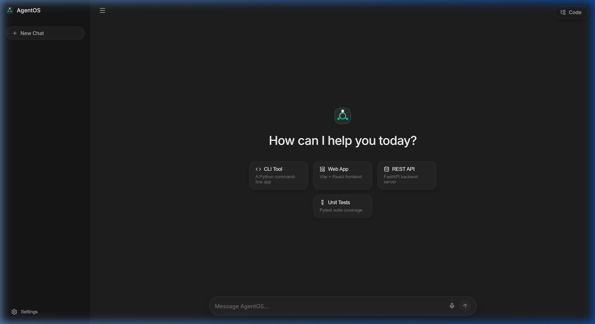
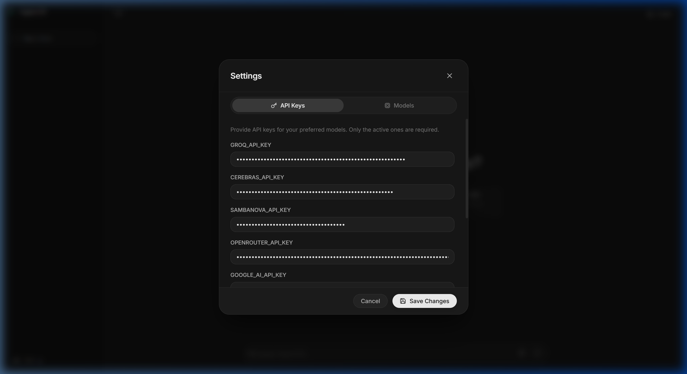
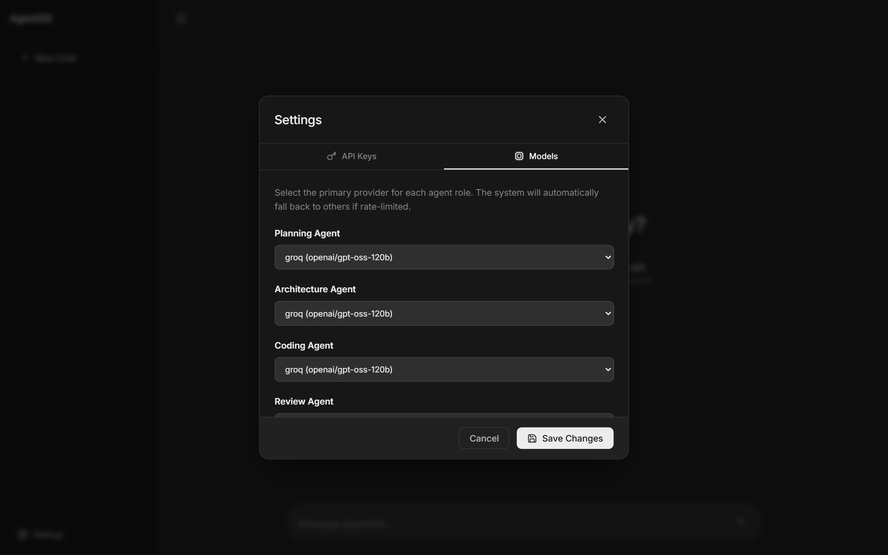
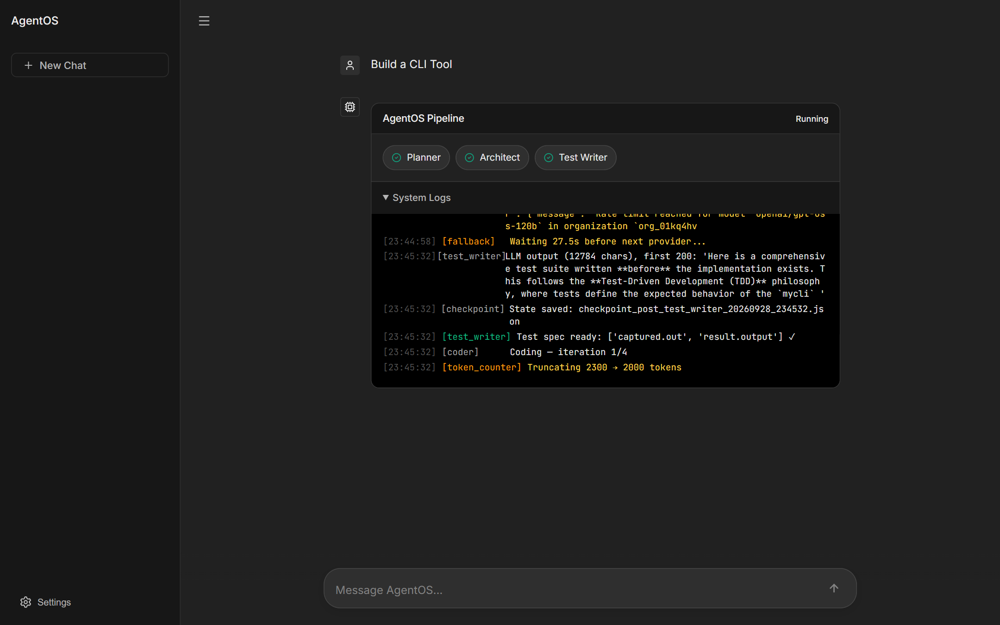
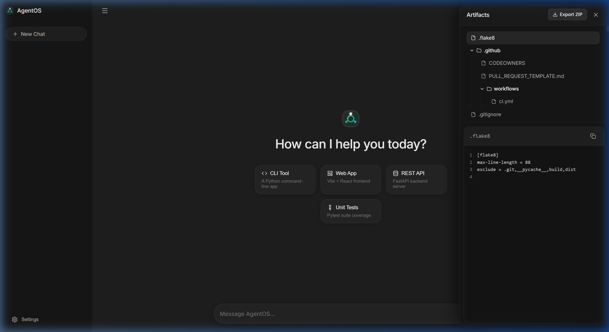

# AgentOS: Multi-Agent AI Software Company in a Box

## Overview

AgentOS is a self-contained, multi-agent AI system that transforms plain English product goals into fully tested software projects. The system autonomously produces complete software including architecture, source code, test suites, and documentation through a compiled LangGraph state machine orchestrating seven specialized AI agents.

The platform features resilient multi-provider LLM routing, rate limit bypass mechanisms, Docker-sandboxed test execution, and a modern React-based web interface for real-time pipeline monitoring and artifact management.

## Core Capabilities

- **Seven Specialized Agents**: Planner, Architect, Test Writer, Coder, Reviewer, Tester, and Fixer — each designed for specific stages of the software development lifecycle
- **LangGraph State Machine**: Compiled pipeline with conditional routing, automatic recovery, and human approval gates
- **Resilient API Routing**: Sophisticated fallback chains with zero-delay failover, adaptive prompt throttling, and dynamic retry-after parsing
- **Docker Sandboxed Testing**: Isolated container execution with host fallback for test suites
- **Modern Web UI**: Dark-mode React dashboard with WebSocket-powered real-time pipeline viewing, settings configuration, and artifact browsing
- **Multi-Provider Support**: Groq, OpenRouter, Cerebras, SambaNova, Google AI, Fireworks, Novita, and HuggingFace with automatic failover

## Repository Structure

```
agentos/
├── main.py                    # CLI entry point
├── launcher.py                # Web UI launcher (starts server + opens browser)
├── api.py                     # FastAPI server with WebSocket streaming
├── graph.py                   # LangGraph state machine (pipeline orchestration)

├── agents/                    # 7 specialized AI agents
│   ├── planner.py             # Goal analysis & dev plan generation
│   ├── architect.py           # System design & file layout
│   ├── test_writer.py         # Pytest suite generation (test-first)
│   ├── coder.py               # Source code implementation
│   ├── reviewer.py            # 3-panel quality/security/performance review
│   ├── tester.py              # Docker sandbox test execution
│   └── fixer.py               # Error-driven code patching

├── router/                    # Multi-provider LLM routing
│   ├── fallback_chain.py      # Rate-limit bypass & resilient failover
│   ├── llm_router.py          # Provider initialization & chain management
│   └── rate_limiter.py        # Per-provider rate tracking

├── tools/                     # Shared utilities
│   ├── logger.py              # Rich console + Web UI log streaming
│   ├── checkpoint.py          # JSON state persistence & recovery
│   ├── docker_sandbox.py      # Docker container test execution
│   ├── _host_runner.py        # Host fallback runner (isolated pytest)
│   ├── token_counter.py       # Token counting & prompt truncation
│   └── error_handler.py       # Error classification & recovery

├── config/                    # Configuration files
│   ├── models.yaml            # Provider chains per agent role
│   ├── thresholds.yaml        # Review scores, iteration limits, Docker settings
│   └── loader.py              # YAML config loader with hot-reload

├── frontend/                  # React + Vite Web UI
│   ├── src/
│   │   ├── App.jsx            # Main application with sidebar & pipeline view
│   │   ├── components/
│   │   │   ├── PipelineViewer.jsx     # Real-time pipeline stage viewer
│   │   │   ├── ArtifactViewer.jsx   # File tree + syntax-highlighted code
│   │   │   └── SettingsModal.jsx    # API keys & model routing settings
│   │   └── App.css              # Dark-mode design system
│   └── dist/                    # Production build (served by FastAPI)

├── output/                    # Generated project output files
├── checkpoints/               # Pipeline state snapshots for recovery
├── requirements.txt           # Python dependencies
├── INSTALL.bat                # Windows automated installer
├── build.py                   # PyInstaller build script
└── .env                       # API keys (not committed)
```

## Architecture Diagram

The following Mermaid flowchart illustrates the complete AgentOS pipeline architecture:

```mermaid
flowchart TB
    %% Styles
    classDef entry fill:#e3f2fd,stroke:#1565c0,stroke-width:2px
    classDef agent fill:#e8f5e9,stroke:#2e7d32,stroke-width:2px
    classDef decision fill:#fff3e0,stroke:#ef6c00,stroke-width:2px
    classDef output fill:#e3f2fd,stroke:#1565c0,stroke-width:2px
    classDef feedback fill:#f3e5f5,stroke:#8e24aa,stroke-width:2px

    %% User Entry Points
    subgraph ENTRY[User Entry Points]
        direction TB
        CLI[CLI Interface]:::entry
        UI[Web UI Interface]:::entry
        API[API Endpoints]:::entry
    end

    %% Graph Layer
    subgraph GRAPH[Compiled LangGraph State Machine]
        direction TB
        PLANNER[Planner: Goal Sanitization & Dev Plan]:::agent
        ARCHITECT[Architect: System Design & File Layout]:::agent
        TESTWRITER[Test Writer: Pytest Suite Generation]:::agent
        CODER[Coder: Source Code Implementation]:::agent
        REVIEWER[Reviewer: 3-Panel Quality/Security/Performance]:::agent
        TESTER[Tester: Docker Sandbox Execution]:::agent
        FIXER[Fixer: Error-Driven Code Patch]:::agent
    end

    %% Output Artifacts
    subgraph OUTPUT[Output & Artifacts]
        direction TB
        GENERATED[Generated Code & Documentation]:::output
        CHECKPOINTS[Pipeline Checkpoints]:::output
    end

    %% Routing Decisions
    subgraph ROUTING[Conditional Routing Logic]
        direction TB
        ROUTE_PLAN[route_after_plan: Score < 30 → Restart, ≥ 30 → Proceed]:::decision
        ROUTE_REVIEW[route_after_review: Score < 30 → Re-architect, 30-74 → Re-code, ≥ 75 → Test]:::decision
        ROUTE_TEST[route_after_test: Failed → Fixer, Passed → Human Approval]:::decision
    end

    %% Connections
    ENTRY -->|Goal| GRAPH
    GRAPH --> PLANNER
    PLANNER -->|Plan| ARCHITECT
    ARCHITECT |>|File Layout & APIs| TESTWRITER
    TESTWRITER |>|Test Suite| CODER
    CODER |>|Source Code| REVIEWER
    REVIEWER |>|Scores| ROUTE_REVIEW

    ROUTE_REVIEW -->|Score < 30| ARCHITECT
    ROUTE_REVIEW |>|Score 30-74| CODER
    ROUTE_REVIEW |>|Score ≥ 75| TESTER

    TESTER -->|Tests Passed| ROUTE_TEST
    TESTER |>|Tests Failed| FIXER

    FIXER -->|Patches Code| CODER
    ROUTE_TEST -->|Human Approval| OUTPUT
    ROUTE_TEST -->|Auto-Approve| OUTPUT

    OUTPUT -->|Project Files| GENERATED
    OUTPUT -->|Snapshots| CHECKPOINTS

    %% Click styling for Mermaid Live Editor
    classDef endStroke:none
```

**Pipeline Flow Summary:**
1. **User Input**: CLI, Web UI, or API submits a product goal
2. **Planner**: Sanitizes input and generates a structured development plan
3. **Architect**: Designs file layout, component APIs, and module boundaries
4. **Test Writer**: Generates comprehensive pytest test suite (test-first)
5. **Coder**: Implements all source files to pass the test suite
6. **Reviewer**: Runs 3 parallel review panels (Quality, Security, Performance) with scoring
7. **Routing Decision**: Based on scores routes to re-architecture, re-coding, or testing
8. **Tester**: Executes pytest in Docker sandbox with isolation
9. **Fixer**: Patches code from test errors (up to 4 iterations)
10. **Output**: Generated artifacts written to `./output/` directory

*Recovery: Up to 4 fix iterations per pass, 3 full pipeline restarts before human escalation.*

## Screenshots

The following screenshots showcase the AgentOS user interface and pipeline monitoring capabilities:

### Dashboard
The main dashboard shows starter templates and a prompt bar for entering custom goals.

<p align="center">
  
</p>

### Settings — API Keys
Configure API keys for multiple LLM providers. Only active providers need keys.

<p align="center">
  
</p>

### Settings — Model Routing
Select the primary provider for each agent role. The system automatically falls back to the next provider if rate-limited.

<p align="center">
  
</p>

### Pipeline Execution
Real-time pipeline viewer showing each agent stage with live status, streaming logs, and completion indicators. Notice the fallback rerouting and token truncation happening in the logs.

<p align="center">
  
</p>

### Artifacts Viewer
Browse generated source files in a hierarchical file tree with syntax-highlighted code preview and one-click copy.

<p align="center">
  
</p>

---

## Rate Limit Bypass & Resilient Rerouting

AgentOS is designed to work with free-tier API keys across multiple providers. The fallback chain implementation provides sophisticated resilience:

### Zero-Delay Failover
When a provider returns HTTP 429 (rate limit), AgentOS immediately switches to the next provider in the chain with only a 0.3-second delay — no blind 30-60 second sleeps.

### Adaptive Prompt Throttling
When a provider rejects a request as "too large" (e.g., Groq's 8,000 TPM limit), AgentOS automatically truncates the prompt to 70% of its size and retries.

### Dynamic Retry-After Parsing
Instead of guessing wait times, AgentOS extracts the provider-specified `retry-after` or `try again in Xs` duration using regex and waits exactly that long, plus a small buffer.

### Multi-Cycle Retries
The pipeline supports up to 3 full cycles through all providers before giving up. Each cycle retries every provider in the chain.

### Emergency Bypass Mode
For development and testing, you can enable bypass mode to skip cloud APIs entirely. When enabled, AgentOS synthesizes valid placeholder responses for each agent role so the pipeline completes without any API calls.

### Provider Chain Configuration
Each agent role has its own ordered fallback chain configured in `config/models.yaml`:

```yaml
models:
  planning:
    chain:
      - { provider: groq,        model: openai/gpt-oss-120b }
      - { provider: groq,        model: qwen/qwen3.8-27b }
      - { provider: openrouter,  model: inclusionai/ling-3.0-flash-sante:free }

  coding:
    chain:
      - { provider: groq,        model: openai/gpt-oss-120b }
      - { provider: openrouter,  model: cohere/north-mini-code:free }
```

## Quick Start

### Prerequisites

- Python 3.10 or later
- At least one LLM API key (Groq free tier recommended)
- Docker (optional, for sandboxed test execution)

### Installation

```bash
# Clone the repository
git clone https://github.com/yourusername/agentos.git
cd agentos

# Install dependencies
pip install -r requirements.txt

# Configure API keys
cp .env.example .env
# Edit .env with your API keys
```

Or use the automated installer on Windows:

```bash
INSTALL.bat
```

### Configure API Keys

Create a `.env` file in the `agentos/` directory:

```
GROQ_API_KEY=gsk_your_key_here
OPENROUTER_API_KEY=sk-or-v1-your_key_here

# Optional additional providers:
CEREBRAS_API_KEY=your_key
SAMBANOVA_API_KEY=your_key
GOOGLE_AI_API_KEY=your_key
FIREWORKS_API_KEY=your_key
```

**Tip**: Only one provider key is required. Groq's free tier is the fastest option. Add more keys for better failover resilience.

### CLI Mode

```bash
# Interactive mode — prompts for a goal
python main.py

# Provide a goal directly
python main.py --goal "Create a REST API for a todo app with SQLite storage"

# Resume from the last checkpoint
python main.py --resume

# Auto-approve output (no interactive confirmation)
python main.py --auto-approve

# Enable rate limit bypass for testing
python main.py --bypass-rate-limits

# Combine flags
python main.py --goal "Build a CLI calculator" --auto-approve --bypass-rate-limits
```

### CLI Options

| Flag                  | Description                                                  |
|-----------------------|--------------------------------------------------------------|
| `--goal TEXT`         | Product goal to build (skips interactive prompt)             |
| `--resume`            | Resume pipeline from the last saved checkpoint                |
| `--auto-approve`      | Automatically write output files without confirmation        |
| `--bypass-rate-limits` | Enable emergency bypass mode for rate-limited APIs          |

### Web UI Mode

Launch the full web interface with a single command:

```bash
python launcher.py
```

This starts a FastAPI + Uvicorn server and opens your browser to `http://127.0.0.1:8000`.

**Alternative (manual)**:

```bash
python -m uvicorn api:app --host 127.0.0.1 --port 8000
# Then open http://127.0.0.1:8000 in your browser
```

#### Web UI Features

- **Template Chips**: One-click starters: CLI Tool, Web App, REST API, Unit Tests
- **Real-Time Pipeline Viewer**: WebSocket-powered live streaming of each agent stage
- **Streaming Logs**: See exactly what each agent is doing in real time
- **Settings Modal**: Configure API keys and model routing from the browser
- **Artifacts Drawer**: Browse generated files with syntax-highlighted code viewer
- **File Tree**: Hierarchical view of all generated source files and tests

## Configuration

### Model Routing — `config/models.yaml`

Each agent role has an ordered fallback chain of providers. Providers are tried in order; the first successful response wins. This file can be edited directly or updated via the **Settings → Models** tab in the Web UI.

```yaml
models:
  planning:
    chain:
      - { provider: groq,        model: openai/gpt-oss-120b }
      - { provider: groq,        model: qwen/qwen3.8-27b }
      - { provider: openrouter,  model: inclusionai/ling-3.0-flash-sante:free }

  coding:
    chain:
      - { provider: groq,        model: openai/gpt-oss-120b }
      - { provider: openrouter,  model: cohere/north-mini-code:free }
```

### Thresholds — `config/thresholds.yaml`

Controls pipeline behavior:

```yaml
review:
  min_score: 75           # Minimum score to pass review
  low_score_arch: 30      # Score below which re-architecture is triggered

loop:
  max_iterations: 4           # Fix iterations per pipeline pass
  max_global_iterations: 3    # Full pipeline restarts before escalation

docker:
  image: "python:3.11-slim"
  timeout_seconds: 120
  memory_limit: "512m"
  network: "none"
```

## Docker Sandbox

By default, AgentOS runs generated test suites inside a Docker container for sandboxed execution:

- Image: `python:3.11-slim`
- Network: disabled (`none`)
- Memory: 512 MB limit
- Timeout: 120 seconds

If Docker is unavailable, AgentOS automatically falls back to isolated host execution with a custom `agentos_pytest.ini` to prevent interference with the host's `pyproject.toml`.

## Supported Providers

| Provider | Key Variable     | Notes                                              |
|----------|------------------|----------------------------------------------------|
| Groq     | `GROQ_API_KEY`   | Fastest inference. Free tier with 8,000 TPM limit. |
| OpenRouter | `OPENROUTER_API_KEY` | Many free models. Good fallback.                |
| Cerebras | `CEREBRAS_API_KEY` | Fast inference, limited free tier.               |
| SambaNova | `SAMBANOVA_API_KEY` | High throughput.                                |
| Google AI | `GOOGLE_AI_API_KEY` | Gemini models. Large context windows.            |
| Fireworks | `FIREWORKS_API_KEY` | Low-latency inference.                          |
| Novita   | `NOVITA_API_KEY`  | Alternative provider.                            |
| HuggingFace | `HF_API_KEY`   | Open-source model hosting.                       |

## Building & Packaging

### PyInstaller Executable

Build a standalone Windows executable:

```bash
python build.py
```

This creates `dist/AgentOS.exe` — a single-file executable that bundles the frontend, all agents, and dependencies.

## Pipeline Execution Flow (Step by Step)

1. **User submits a goal** via CLI or Web UI
2. **Planner** sanitizes input, generates a structured development plan
3. **Architect** designs the file layout, module boundaries, and component APIs
4. **Test Writer** generates a pytest test suite from the architecture (test-first)
5. **Coder** writes all source files to pass the tests
6. **Reviewer** runs 3 parallel review panels (quality, security, performance) and assigns scores
7. **Routing decision**:
   - Score < 30 → back to Architect for re-architecture
   - Score 30–74 → back to Coder with specific feedback
   - Score ≥ 75 → proceed to Tester
8. **Tester** runs pytest in Docker sandbox
9. **If tests fail** → Fixer patches code, loops back to Tester (up to 4 iterations)
10. **If tests pass** → Human approval gate (or auto-approve if flag enabled)
11. **Output** written to `./output/` directory

If any stage exhausts all retries, the pipeline restarts from scratch (up to 3 full restarts). If all restarts fail, it escalates to human intervention with a diagnostic report.

## Development

### Running the Frontend in Dev Mode

```bash
cd frontend
npm install
npm run dev       # Vite dev server with hot-reload
```

### Running the Backend Only

```bash
python -m uvicorn api:app --host 127.0.0.1 --port 8000 --reload
```

### Rebuilding the Frontend for Production

```bash
cd frontend
npm run build     # Outputs to frontend/dist/
```

The FastAPI server automatically serves the built frontend from `frontend/dist/`.

## Environment Variables

| Variable                | Default | Description                                                  |
|-------------------------|---------|--------------------------------------------------------------|
| `AGENTOS_WEB_MODE`      | `0`     | Set to `1` when running via Web UI (auto-set by `api.py`)    |
| `AGENTOS_AUTO_APPROVE`  | `0`     | Set to `1` to skip human approval gate                       |
| `AGENTOS_BYPASS_RATE_LIMIT` | `0` | Set to `1` for emergency rate limit bypass                   |
| `AGENTOS_ALLOW_EMERGENCY_FALLBACK` | `0` | Set to `1` to allow synthesized responses on total failure |

## Contributing

Contributions are welcome! The codebase is modular — each agent, tool, and router component is self-contained.

1. Fork the repository
2. Create a feature branch
3. Make your changes
4. Submit a pull request

## License

This project is licensed under the MIT License.

---

<strong>Built with LangGraph, FastAPI, and React</strong>